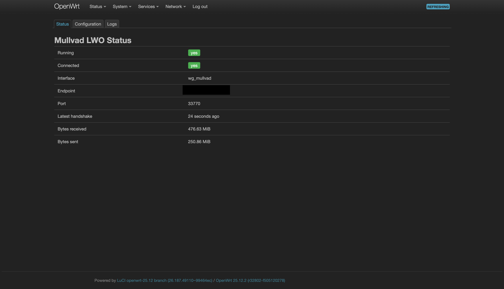
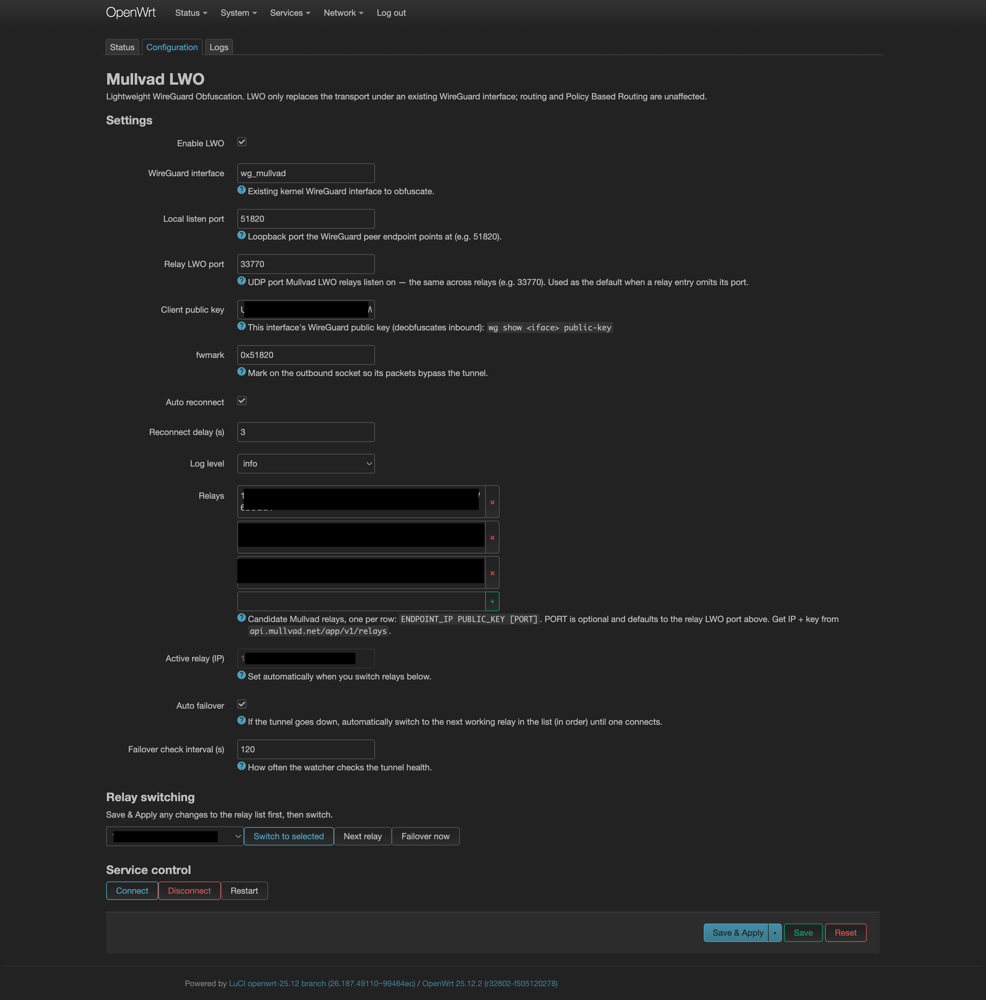

# mullvad-lwo for OpenWrt

> **Note:** This project was developed with the help of Claude AI. I understand the code,
> stand behind it, and maintain it — the AI was a tool, with a human in the loop throughout.
> The obfuscation core is vendored verbatim from Mullvad (see [`docs/UPSTREAM.md`](docs/UPSTREAM.md));
> the surrounding OpenWrt glue was AI-assisted and validated end-to-end on real hardware.

Bring **Mullvad's Lightweight WireGuard Obfuscation (LWO)** to OpenWrt — no Mullvad GUI, no
`mullvad-daemon`, just a small router-friendly daemon that obfuscates an existing WireGuard
tunnel's transport.

- **Reuses Mullvad's protocol verbatim.** The obfuscation itself is vendored unchanged from
  [`mullvadvpn-app`](https://github.com/mullvad/mullvadvpn-app)
  (`tunnel-obfuscation/src/lwo.rs`, GPL-3.0). See [`docs/UPSTREAM.md`](docs/UPSTREAM.md).
- **Tiny.** `tokio` + `rand` (+ `nix` for fwmark). No shadowsocks/QUIC/gRPC. Fits a ~73 MB
  overlay and cross-compiles quickly for `armv7 musl`.
- **Native OpenWrt.** procd service, UCI config, LuCI app. Leaves kernel WireGuard, routing,
  and Policy Based Routing (`pbr`) untouched — it only replaces the transport.

Primary target: **Google Wifi AC-1304** (`arm_cortex-a7_neon-vfpv4`), OpenWrt 25.12,
kernel 6.12.

## How it works (one paragraph)

LWO is a local UDP proxy. You point your WireGuard peer `endpoint` at `127.0.0.1:<port>`; the
`lwo-proxy` daemon obfuscates each WireGuard packet (XORing only the fixed header with a
32-byte WireGuard public key and setting an obfuscation bit) and forwards it to the real
server; the return path deobfuscates. Payload is untouched, so overhead is **0 bytes** and
throughput stays high. Full analysis in [`docs/01-research-mullvad-lwo.md`](docs/01-research-mullvad-lwo.md).

```
kernel WireGuard --(loopback)--> lwo-proxy --obfuscate--> WAN --> Mullvad server
kernel WireGuard <--(loopback)-- lwo-proxy <--deobfuscate-- WAN <-- Mullvad server
```

## Packages

| Package | Contents |
|---|---|
| `lwo-proxy` | daemon + `lwo-switch` / `lwo-failover` helpers, UCI config (`/etc/config/lwo`), procd init, hotplug |
| `luci-app-mullvad-lwo` | LuCI Status / Configuration / Logs pages + relay-switching UI |

## Install

**From the apk feed (recommended)** — one-time setup on the router, then it's installable and
auto-upgradable from **System → Software**:

```sh
# trust the feed's signing key, then add the feed
wget -O /etc/apk/keys/lwo-feed.pem https://mohsen2hasani.github.io/LWO/public-key.pem
echo 'https://mohsen2hasani.github.io/LWO/arm_cortex-a7_neon-vfpv4/packages.adb' > /etc/apk/repositories.d/lwo.list
apk update
apk add lwo-proxy luci-app-mullvad-lwo
```

The feed targets **`arm_cortex-a7_neon-vfpv4`** (Google Wifi AC-1304 / OpenWrt 25.12); for
other targets, build the packages yourself. Details and how the feed is published:
[`docs/FEED.md`](docs/FEED.md).

**Or build them yourself** — via the OpenWrt SDK or the CI artifacts:
[`docs/INSTALL.md`](docs/INSTALL.md).

Either way, the procd services are auto-enabled on install — no `service … enable` step.

## Using it

**Configure & operate — all in LuCI** (`Services → Mullvad LWO`):
- **Status** — running / connected, endpoint, latest handshake, bytes in/out.
- **Configuration** — enable LWO, choose the WireGuard interface, and manage the **Relays**
  list (one `IP KEY [PORT]` per row — any WireGuard port works for LWO, so `PORT` is
  usually omitted). Buttons: **Switch to selected / Next relay / Failover now**, and
  **Connect / Disconnect / Restart**. Tick **Auto failover** (+ interval) and the router
  automatically moves to the next working relay if the current one dies — no scripts, no cron.
- **Logs** — live daemon log.

| Status | Configuration |
|---|---|
| [](docs/images/Status.png) | [](docs/images/Configuration.png) |

**From the shell** (equivalent to the buttons):
```sh
service lwo {start|stop|restart}
lwo-switch {list | use <ip> | next | check | failover}
```

The one thing that's still a one-time CLI step is pointing a WireGuard interface at the proxy
(`endpoint = 127.0.0.1:<listen_port>`) — the full first-time walkthrough is below.

## Full setup: Mullvad on OpenWrt with LWO

This is the complete, **field-validated** walkthrough (tested on a Google Wifi AC-1304,
OpenWrt 25.12.2, `ipq40xx/chromium`, against Mullvad relay `nl-ams-wg-008` — LWO successfully
carried traffic through an ISP that blocks plain WireGuard).

> LWO obfuscates an **existing** WireGuard tunnel — it does not create one. So the flow is:
> build a Mullvad WireGuard client on the router, then put LWO under it. On a freshly-flashed
> OpenWrt there is no WireGuard yet, so start at Step 0.

Values written like `<LIKE_THIS>` are yours to fill in. The example relay/port/keys below are
just that — examples; get your own in Step 3.

### Step 0 — Get the router online

`apk` needs internet. Plug the router's **WAN** port into your upstream modem/router and check:

```sh
ping -c2 1.1.1.1 && ping -c2 downloads.openwrt.org
```

If the LAN subnet clashes with your upstream (both `192.168.1.0/24`), move OpenWrt's LAN:
`uci set network.lan.ipaddr='192.168.9.1'; uci commit network; /etc/init.d/network restart`.

### Step 1 — Install the packages + WireGuard stack

Copy the two built `.apk`s to the router (see [`docs/INSTALL.md`](docs/INSTALL.md) to build
them). Note: OpenWrt's Dropbear has no SFTP server, so `scp` needs **`-O`**:

```sh
scp -O lwo-proxy-*.apk luci-app-mullvad-lwo-*.apk root@192.168.1.1:/tmp/
```

On the router:

```sh
apk update
apk add --allow-untrusted /tmp/lwo-proxy-*.apk /tmp/luci-app-mullvad-lwo-*.apk
apk add kmod-wireguard wireguard-tools luci-proto-wireguard
wg --version
```

### Step 2 — Create a Mullvad WireGuard key

At **mullvad.net → Account → WireGuard configuration**, generate & download a `.conf`
(any server; the key works with any relay). You need two lines from it:

- `PrivateKey = …`  → the router's interface private key
- `Address = 10.x.x.x/32`  → the router's tunnel address

### Step 3 — Find the LWO relay endpoint, port, and server key

Mullvad's public relay API lists every relay's IP and WireGuard public key, and marks the
ones that support LWO with `features.lwo`. This prints them for one location (here `nl-ams`)
as `IP KEY` lines, ready for the relay list or the LuCI **Import relays from file** button:

```sh
curl -s "https://api.mullvad.net/app/v1/relays" | python3 -c '
import sys, json
for r in json.load(sys.stdin)["wireguard"]["relays"]:
    if r["active"] and "lwo" in r.get("features", {}) and r["location"] == "nl-ams":
        print(r["ipv4_addr_in"], r["public_key"], "#", r["hostname"])'
# 193.32.249.73 hf+klJbIyUoGUaFHgac9W+yriwb9uvSnafDfnmEW9Hc= # nl-ams-wg-008
```

The LWO **port** is not tied to the relay: LWO reuses the WireGuard endpoint, so any port in
the API's WireGuard `port_ranges` works (e.g. `51820`, `33770`).

So you now have: `server=193.32.249.73`, `server_port=33770`, `server_pubkey=<relay key>`.

### Step 4 — Create the WireGuard interface (endpoint = the local proxy)

The peer endpoint points at **`127.0.0.1:51820`** (the LWO proxy), and routing uses **split
default routes** `0.0.0.0/1` + `128.0.0.0/1` — *not* `0.0.0.0/0`, which netifd drops on a
network restart and silently leaks via WAN (see Troubleshooting).

```sh
uci -q delete network.wg_mullvad
uci set network.wg_mullvad=interface
uci set network.wg_mullvad.proto='wireguard'
uci set network.wg_mullvad.private_key='<PRIVATE_KEY>'
uci add_list network.wg_mullvad.addresses='<ADDRESS>'          # e.g. 10.69.37.10/32

uci -q delete network.wgpeer_mullvad
uci set network.wgpeer_mullvad=wireguard_wg_mullvad
uci set network.wgpeer_mullvad.public_key='<SERVER_PUBKEY>'
uci set network.wgpeer_mullvad.endpoint_host='127.0.0.1'
uci set network.wgpeer_mullvad.endpoint_port='51820'
uci add_list network.wgpeer_mullvad.allowed_ips='0.0.0.0/1'
uci add_list network.wgpeer_mullvad.allowed_ips='128.0.0.0/1'
uci set network.wgpeer_mullvad.route_allowed_ips='1'
uci set network.wgpeer_mullvad.persistent_keepalive='25'
uci commit network
/etc/init.d/network restart

wg show wg_mullvad public-key        # this is your client_pubkey for Step 5
```

### Step 5 — Configure and start LWO

```sh
uci set lwo.main.enabled='1'
uci set lwo.main.interface='wg_mullvad'
uci set lwo.main.listen_port='51820'
uci set lwo.main.server='193.32.249.73'
uci set lwo.main.server_port='33770'
uci set lwo.main.server_pubkey='<SERVER_PUBKEY>'
uci set lwo.main.client_pubkey='<CLIENT_PUBKEY_FROM_STEP_4>'
uci commit lwo
service lwo enable
service lwo start
```

Key direction matters: `server_pubkey` is the **relay's** key; `client_pubkey` is your
**interface's** key. Swapping them = a silent, handshake-less tunnel.

### Step 6 — Routing, firewall/NAT, IPv6, DNS

```sh
# NAT the LAN out through the tunnel
uci add firewall zone
uci set firewall.@zone[-1].name='vpn'
uci set firewall.@zone[-1].input='REJECT'
uci set firewall.@zone[-1].output='ACCEPT'
uci set firewall.@zone[-1].forward='REJECT'
uci set firewall.@zone[-1].masq='1'
uci set firewall.@zone[-1].mtu_fix='1'
uci add_list firewall.@zone[-1].network='wg_mullvad'
uci add firewall forwarding
uci set firewall.@forwarding[-1].src='lan'
uci set firewall.@forwarding[-1].dest='vpn'
uci commit firewall

# keep the proxy's own traffic to the relay OFF the tunnel (no loop)
WAN_GW=$(ip route show default | awk '/default/{print $3; exit}')
uci set network.lwo_bypass=route
uci set network.lwo_bypass.interface='wan'
uci set network.lwo_bypass.target='193.32.249.73/32'
uci set network.lwo_bypass.gateway="$WAN_GW"

# disable IPv6 (no Mullvad v6 address here -> avoids EPERM + leaks)
uci set network.wan6.disabled='1'
uci -q delete network.globals.ula_prefix
uci commit network
uci set dhcp.lan.ra='disabled'
uci set dhcp.lan.dhcpv6='disabled'

# DNS through Mullvad (no leak)
uci -q delete dhcp.@dnsmasq[0].server
uci add_list dhcp.@dnsmasq[0].server='10.64.0.1'
uci set dhcp.@dnsmasq[0].noresolv='1'
uci commit dhcp

/etc/init.d/network restart
/etc/init.d/firewall restart
/etc/init.d/dnsmasq restart
service lwo restart
```

### Verify

```sh
wg show wg_mullvad | grep -E 'handshake|transfer'   # fresh handshake, counters growing
ip route get 8.8.8.8                                 # must say: dev wg_mullvad
uclient-fetch -qO- https://am.i.mullvad.net/connected ; echo
#   -> "You are connected to Mullvad (server nl-ams-wg-008). Your IP address is 193.32.249.x"
```

Then connect a LAN device and open `https://mullvad.net/check`. Everything can also be driven
from the LuCI **Configuration** / **Status** / **Logs** pages.

## Troubleshooting / debugging

Symptoms and fixes seen while getting this working end-to-end:

| Symptom | Cause | Fix |
|---|---|---|
| `scp` → `ash: /usr/libexec/sftp-server: not found` | Dropbear has no SFTP server | use `scp -O …`, or `ssh root@ip 'cat > /tmp/x' < x` |
| `apk` → `wget: Operation not permitted` (error 4) | usually a dead IPv6 path (apk tried an AAAA mirror) | retry; or `uci set network.wan6.disabled=1; /etc/init.d/network restart` |
| `uclient-fetch` → `Operation not permitted` but `ping` works | DNS returned an **IPv6** address and IPv6 is dead | disable IPv6 (Step 6); test with `-4`, or a v4-only host |
| Handshake OK, but exit IP is still your real IP | traffic isn't routed into the tunnel | `ip route get 8.8.8.8` must show `dev wg_mullvad`; use the **split `/1` routes** from Step 4 |
| Worked, then broke after `network restart` | netifd dropped a `0.0.0.0/0` wg default | use split `0.0.0.0/1` + `128.0.0.0/1` (survives restarts) |
| Connected but ISP still sees your DNS | resolver still going out WAN | point dnsmasq at `10.64.0.1` + `noresolv=1` (Step 6) |
| No handshake at all | wrong key direction, or relay doesn't support LWO | `server_pubkey`=relay, `client_pubkey`=interface; check the relay has `features.lwo` in the relay API |

**Key diagnostic commands**

```sh
wg show wg_mullvad                     # handshake age + transfer counters (the transport)
logread -e lwo | tail -20             # lwo-proxy startup / errors
ip route get 8.8.8.8                  # is normal traffic using wg_mullvad?
ip route get <RELAY_IP>               # relay must be reachable via WAN (not the tunnel)
uclient-fetch -4 -qO- https://icanhazip.com ; echo   # exit IP (v4-forced)
```

> Note: a working LWO handshake **proves your ISP is not blocking you** — the obfuscated
> packets reach the relay on the LWO port and it replies. If you can handshake but have no
> internet, the problem is local **routing/DNS**, not the ISP.

## Multiple relays & failover

Across Mullvad relays only the **endpoint IP** and the **peer public key** change — the LWO
port is the same and your client key/address are fixed. So you can keep a list of relays and
switch between them (or auto-failover) with the bundled **`lwo-switch`** helper.

Define the relays as a UCI list in `/etc/config/lwo` (one row each, `IP KEY [PORT]`; `PORT`
optional, defaults to `server_port`):

```sh
uci set lwo.main.wg_interface='wg_mullvad'   # WG sections lwo-switch reconfigures
uci set lwo.main.wg_peer='wgpeer_mullvad'
uci set lwo.main.bypass_route='lwo_bypass'
uci set lwo.main.handshake_max='180'         # tunnel is "down" if older than this
uci add_list lwo.main.peer='193.32.249.73 hf+klJbIyUoGUaFHgac9W+yriwb9uvSnafDfnmEW9Hc='
uci add_list lwo.main.peer='185.65.134.82 DVui+5aifNFRIVDjH3v2y+dQ+uwI+HFZOd21ajbEpBo='
uci commit lwo
```
Get each relay's `IP` + `KEY` from `https://api.mullvad.net/app/v1/relays`.

Then:

```sh
lwo-switch list              # show relays, mark the active one, show handshake age
lwo-switch use 185.65.134.82 # switch to a specific relay (and verify the handshake)
lwo-switch next              # rotate to the next relay in the list
lwo-switch check             # exit 0 if the tunnel is healthy
lwo-switch failover          # if the tunnel is stale, try relays until one connects
```

A switch updates the proxy (`server`/`server_pubkey`/`server_port`), the kernel WireGuard
peer key, and the `/32` relay-bypass route in one step, then restarts and checks the handshake.

**Automatic failover (built-in).** Set `lwo.main.failover='1'` (or tick **Auto failover** in
LuCI). The `lwo-failover` service then checks the tunnel every `failover_interval` seconds and,
if the handshake is stale, walks the `peer` list in order until one connects — no cron needed:
```sh
uci set lwo.main.failover='1'
uci set lwo.main.failover_interval='120'
uci commit lwo
/etc/init.d/lwo-failover restart
```

In **LuCI → Services → Mullvad LWO → Configuration**, the relays are a multi-row **Relays**
field with a dropdown + **Switch / Next / Failover** buttons, and an **Auto failover** checkbox
+ interval. So end users can set everything up in the GUI without touching the shell.

**Importing a relay list.** Instead of adding rows one by one, use **Import relays from file**
on the same page: a plain text file with one `IP KEY [PORT]` per line (blank lines and `#`
comments ignored). Relays whose IP is already listed are updated; tick **Replace the whole
list** to start fresh. Then **Save & Apply**.

**Automatic relay list per country.** Pick a **Country** on the Configuration page and press
**Update relay list**. The router downloads that country's LWO relays from the Mullvad API,
tests each one from your own connection and keeps only the ones that connect. Your ISP may
block some relays or ports. If the active relay didn't pass, it switches to the first one that
did. The working relays are then **ranked by packet loss and latency** over plain WAN (your
ISP's path is usually what limits speed) and the list is saved best-first. The update switches
to the best one, and failover and **Next relay** follow that order. Choose how relays are
tested with **Relay test mode** (`lwo.main.probe_mode`) below. Each downloaded relay list is
also saved to `/etc/lwo/relays.json.gz` (kept across reboots and sysupgrade) and used when the
Mullvad API can't be reached, e.g. right after a reboot on a network that blocks or throttles it:

- **Pause internet** (`switch`, default): no setup. The main tunnel moves to each relay for a
  few seconds, then reconnects to the best one. Traffic is dropped while it tests, never leaked.
- **Second device** (`device`): the internet stays up. Relays are tested on a temporary
  `wg_probe` interface with a temporary `/32` route via WAN, using a **second Mullvad device
  key**, so your main device never shows up on two relays at once.

```sh
uci set lwo.main.country='nl'
# only for 'device' mode:
#   wg genkey | tee /tmp/probe.key | wg pubkey   # add this public key to your account as a new device
#   uci set lwo.main.probe_mode='device'
#   uci set lwo.main.probe_private_key="$(cat /tmp/probe.key)"; rm /tmp/probe.key
uci commit lwo
lwo-switch update            # same as the LuCI button; progress in `logread -e lwo`
```
The update replaces the whole relay list with that country's working relays. It tests at most
`max_relays` (default 20, a random pick, your current relay always included), needs LWO to be
enabled and connected, and blocks Switch/Next/Failover while it runs. In **Pause internet** mode
nothing is written to flash until the end, so a reboot mid-test comes back on your old relay.

**Regions.** Instead of one country you can pick a whole region: `europe`, `north-america`,
`south-america`, `asia`, `oceania`, `middle-east`, `africa`, or `all`. The LuCI list groups
the countries by region. A region usually finds faster relays than one country: up to
`region_per_country` relays (default 3) of each country are pinged at once over WAN, and only
the best `max_relays` of those are tested and ranked as above.

**Access check** (`access_check`, needs `curl`). Some relays connect but are useless: no data
gets through, or sites block them. With this on, every relay that connects also gets real
traffic sent through it. Data must pass (`access_data_url`, 3 tries), and none of the
`access_url` sites may answer 403, 429 or nothing, or show a page matching
`access_block_regex` ("you have been blocked", "not available in your country", Google's
"unusual traffic", ...). A Cloudflare browser challenge (`cf-mitigated: challenge`) is not
counted as a block. The defaults are claude.ai, api.anthropic.com, Gemini, Google search and
cloudflare.com. Relays that fail are dropped from the list. The traffic goes out of the tunnel
through a private routing table that only applies to the tunnel's own address, so nothing else
on the router changes. In **Second device** mode set `probe_address` to that device's tunnel IP
(the `Address` line of its Mullvad WireGuard config).

**Fall back to any country** (`fallback_any`). If no relay of the chosen country or region
works (or passes the access check), the update looks for the fastest working relay anywhere
(like `all`). The chosen country is kept, so the next update tries it first again. With auto
failover on, a failover that finds every listed relay down also runs an update, at most once
every 15 minutes.

```sh
uci set lwo.main.country='europe'
uci set lwo.main.access_check='1'      # apk add curl
uci set lwo.main.fallback_any='1'
uci commit lwo
lwo-switch update
```

**No leak while switching.** `lwo-switch` swaps the WireGuard peer and the relay-bypass route
live, without taking `wg_mullvad` down, so the tunnel routes stay in place. During the switch,
traffic goes into the tunnel and is dropped until the new relay handshakes. It never falls back
to WAN.

## Upgrading OpenWrt

LWO isn't in the official OpenWrt feeds, so the firmware upgrade can't include it. Instead, the
router keeps LWO's files through the upgrade, and you re-install the packages afterwards. You
need LWO **1.2.0 or newer** installed before you start.

**1. Before: check that LWO's files will be kept.**
```sh
sysupgrade -l | grep lwo
```
You should see `/usr/sbin/lwo-proxy`, `/usr/sbin/lwo-switch` and `/etc/rc.d/S90lwo` among others.
If the list is empty, don't upgrade. Update LWO first.

**2. Upgrade, leaving out the two LWO packages.** Keep your settings.
```sh
owut upgrade -r lwo-proxy,luci-app-mullvad-lwo
```
If you use LuCI's **Attended Sysupgrade** page instead, remove the two LWO packages from its
package list and keep **Keep settings** ticked.

**3. After the reboot: check the tunnel.**
```sh
lwo-switch check
uclient-fetch -4 -q -O - https://am.i.mullvad.net/connected
```

**4. Re-install the packages**, so `apk` tracks them and you get future updates:
```sh
apk update && apk add lwo-proxy luci-app-mullvad-lwo
```
You can also do this in **System → Software**: **Update lists**, filter `lwo`, then install both.

**If there's no internet after the reboot**, turn the tunnel off for a moment, reinstall, and
turn it back on. While the tunnel is off, traffic uses your real IP:
```sh
ifdown wg_mullvad; uci -q delete dhcp.@dnsmasq[0].server; uci set dhcp.@dnsmasq[0].noresolv=0; service dnsmasq restart
apk update && apk add lwo-proxy luci-app-mullvad-lwo
uci revert dhcp; service dnsmasq restart; ifup wg_mullvad
```

## Quick start (if WireGuard is already set up)

1. Install the packages (see [`docs/INSTALL.md`](docs/INSTALL.md)).
2. Point your WireGuard peer endpoint at `127.0.0.1:51820` and fill in `/etc/config/lwo`.
3. `service lwo enable && service lwo start`, or use the LuCI **Configuration** page.
4. Check **Status** (or `wg show`) for a recent handshake.

## Repository layout

```
lwo-proxy/                     Rust daemon (protocol vendored in src/lwo_core.rs)
package/lwo-proxy/             OpenWrt Makefile + procd/UCI/hotplug files
package/luci-app-mullvad-lwo/  LuCI app (JS views, rpcd backend, ACL, menu)
docs/                          research, architecture, routing, testing, guides
.github/workflows/ci.yml       host tests + OpenWrt SDK package builds
```

## Documentation

- [01 — Research: how Mullvad LWO works](docs/01-research-mullvad-lwo.md)
- [02 — Architecture](docs/02-architecture.md)
- [03 — Prototype & cross-compilation](docs/03-prototype.md)
- [07 — Routing & pbr](docs/07-routing-pbr.md)
- [09 — Testing checklist](docs/09-testing-checklist.md)
- [10 — User / developer / maintainer docs & troubleshooting](docs/10-documentation.md)
- [Installation](docs/INSTALL.md) · [apk feed / Software-panel install](docs/FEED.md) · [Upstream vendoring](docs/UPSTREAM.md)

## License

Copyright (C) 2026  mohsen2hasani

This program is free software: you can redistribute it and/or modify it under the terms of the
GNU General Public License as published by the Free Software Foundation, either version 3 of
the License, or (at your option) any later version.

This program is distributed in the hope that it will be useful, but WITHOUT ANY WARRANTY;
without even the implied warranty of MERCHANTABILITY or FITNESS FOR A PARTICULAR PURPOSE. See
the GNU General Public License for more details.

The obfuscation core (`lwo-proxy/src/lwo_core.rs`) is derived from Mullvad's
GPL-3.0-or-later code — Copyright (C) 2026 Mullvad VPN AB — see
[`docs/UPSTREAM.md`](docs/UPSTREAM.md). For the full license text, see [`LICENSE.md`](LICENSE.md).

## Status

Independent project; not affiliated with or endorsed by Mullvad VPN AB. Intended for eventual
upstreaming to OpenWrt Packages or Mullvad, or as a standalone feed.
